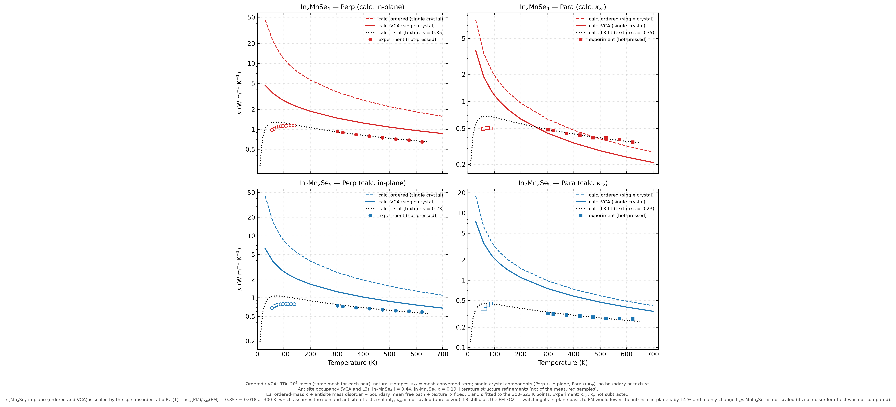

# MnIn₂Se₄ / Mn₂In₂Se₅ lattice thermal conductivity — progress report

**Date:** 2026-11-18, **updated 2026-11-21**: Mn₂In₂Se₅ FC3-cutoff verdict
(hold-out test, `test/Mn2In2Se5/cutoff_cv/`) and Mn₂In₂Se₅ antisite occupancy
switched to the literature x = 0.19 (VCA and L3).  
**Scope:** both materials. This report supersedes the status sections of
earlier summaries. The detailed derivations live in
[`REPORT_MnIn2Se4_20261115.md`](REPORT_MnIn2Se4_20261115.md); section numbers (§) below refer to it.

---

## 1. Summary

- **The calculation is complete within the agreed ≈ 10 % target.** The q-mesh,
  isotopes, LBTE versus RTA, and the coherence term have all been settled.
- **The remaining uncertainty is the FC3 cutoff**:
  - MnIn₂Se₄: the cutoff steps shrink, and the remaining error is ≲ 10 %.
  - Mn₂In₂Se₅ (settled 2026-11-21, no new DFT): refits above 6.51 Å on the
    existing 54 frames are over-parameterised (hold-out validation). 6.51 Å
    stays; the next step (6.90 Å) is no more negative than −3.3 % in κ_zz and
    −2.1 % in-plane. Earlier versions called these values upper bounds.
- **Intrinsic single-crystal κ is 3–4× above the hot-pressed measurements.**
  Mn/In antisite mass disorder (VCA) closes part of the gap. A nanoscale
  phonon mean free path (L_eff ≈ 10–50 nm) is needed to reach the measured
  values. The low-temperature data show this most clearly.

## 2. Values to quote (300 K, W m⁻¹ K⁻¹)

| | MnIn₂Se₄ | Mn₂In₂Se₅ |
|---|---:|---:|
| **in-plane κ** (LBTE + coherence) | **≈ 4.6** (4.67) | **≈ 2.9** (3.37 × 0.857 = 2.89) |
| **κ_zz** (mesh-converged + coherence) | **≈ 0.71** (0.648 + 0.066) | **≈ 1.09** (0.977 + 0.112) |
| κ_zz at 10 μm / 1 μm grain (no coherence) | 0.638 / 0.58 | 0.944 / 0.798 |
| FC3 cutoff, in-plane | ≈ −10 %, estimated (steps −22.9 % → −8.7 %) | steps −3.9 % → −4.3 %; next step ≥ **−2.1 %** |
| FC3 cutoff, κ_zz | ≈ −10 %, estimated (steps −50.5 % → −8.2 %) | steps −11.9 % → −9.9 %; next step ≥ **−3.3 %** |
| experiment κ_tot, Perp / Para (303 K, hot-pressed) | 0.933 / 0.485 | 0.741 / 0.320 |

What each number is made of:

- **MnIn₂Se₄ in-plane**: LBTE 4.5219 at 14³, +1.3 % mesh correction from
  the RTA series, + coherence 0.09 (phono3py 3.24.0).
- **Mn₂In₂Se₅ in-plane**: RTA 3.048 (32³), with the iterative and coherence
  corrections (`analysis/disorder/README.md` §4.4), then multiplied by the
  spin-disorder ratio **R_xx(300 K) = 0.857 ± 0.018** = κ_xx(PM)/κ_xx(FM_ctl)
  from the spin-disordered FC2 (`dft/spin_disorder_fc2/results/KAPPA_VERDICT.md`,
  `R_xx_vs_T.json`). Spin disorder lowers the in-plane single-crystal κ by 14 %,
  above the 5 % decision threshold, so the in-plane L1 now uses the paramagnetic FC2.
  - **Approximate step**: R_xx is an RTA ratio applied to the LBTE + coherence
    value; that the same ratio holds for that composition is assumed, not shown.
  - **κ_zz is not rescaled**: this dataset cannot resolve the spin effect there
    (PM/FM_ctl = 0.47–0.88 over the jackknife, and the FM control is itself
    +22 % off production). κ_zz therefore keeps the FM value and stays an upper
    bound because of the FC3 cutoff.
  - **MnIn₂Se₄ is not rescaled**: its spin-disorder effect was not computed.
- **κ_zz**: mesh-converged rest term, i.e. the Γ–Z quadrature error removed
  (§6.3–6.5).
  - MnIn₂Se₄: 0.648 ± 0.003 (14³–30³).
  - Mn₂In₂Se₅: 0.977 ± 0.008 (plateau over 24³–32³, isotopes on).

Two comparisons to keep in mind:

- **In-plane ordering is robust.** MnIn₂Se₄ > Mn₂In₂Se₅ by 37 %, well above
  the cutoff effects.
- **κ_zz ordering now holds within what the data can test.** Mn₂In₂Se₅ is
  50 % above MnIn₂Se₄, and its next cutoff step is bounded at −3.3 %. Cutoffs
  above 6.90 Å are untested. (Before 2026-11-21 this read "not robust", because the
  Mn₂In₂Se₅ value was treated as an unbounded upper bound.)

**Texture-independent comparison with experiment**, (2κ_xx + κ_zz)/3 against
(2·Perp + Para)/3 at 300 K:

| | MnIn₂Se₄ | Mn₂In₂Se₅ |
|---|---:|---:|
| experiment | 0.784 | 0.601 |
| calc., quoted values (LBTE + coherence) | 3.35 (4.3×) | 2.61 (4.3×) |
| calc., ordered, RTA 20³ | 2.67 (3.4×) | 2.33 (3.9×) |
| calc., VCA, RTA 20³ | 1.14 (1.5×) | 1.23 (2.0×) |
| calc., L3 extrinsic fit | 0.78 (fitted to these data) | 0.63 (fitted to these data) |

Both VCA rows use the literature antisite fraction (MnIn₂Se₄ i = 0.44,
Mn₂In₂Se₅ x = 0.19). The Mn₂In₂Se₅ row read 1.35 (2.3×) with the earlier
x = 0.13. The L3 rows have x fixed at the same values and only L and s fitted.

## 3. Figures

All three are produced by
[`test/figures/paper/make_paper_figures.py`](test/figures/paper/make_paper_figures.py)
from data in the repository. The κ_zz convention is the same as in §2.

### Fig. 1 — intrinsic κ(T)

- **Lines:** RTA population, ordered crystal, natural isotopes; 14³ for
  MnIn₂Se₄, 16³ for Mn₂In₂Se₅.
- **Stars:** the 300 K values of §2.
  - The stars sit above the RTA lines because LBTE exceeds RTA in-plane (24 %
    for MnIn₂Se₄) and because they include the coherence term.
  - Bars: the cutoff uncertainty. MnIn₂Se₄ ≈ −10 % (estimate); Mn₂In₂Se₅
    −3.3 % / −2.1 % (bound on the next step from the hold-out test).

### Fig. 2 — calculation against the hot-pressed experiment

- **Dashed / solid:** ordered / VCA single-crystal curves.
  - RTA, 20³ pairs, Perp ↔ in-plane, Para ↔ κ_zz.
  - No boundary or texture, so these are an upper reference.
- **Dotted:** L3 extrinsic model, i.e. ordered-mass κ + antisite mass
  disorder + boundary mean free path + texture, fitted to 300–623 K.
- **Symbols:** experiment; filled is high T, open is low T. It is κ_tot with
  κ_e not subtracted.
- **Main reading:** VCA lowers κ strongly but stays well above experiment, and
  it cannot produce the low-temperature maximum near 100 K. That maximum needs
  a nanoscale mean free path.

### Fig. 3 — the remaining uncertainty: FC3 cutoff

300 K, normalised to the largest cutoff used (6.45 / 6.51 Å). The MnIn₂Se₄
steps shrink; the Mn₂In₂Se₅ steps do not.

## 4. Disorder and extrinsic parameters

| | MnIn₂Se₄ | Mn₂In₂Se₅ |
|---|---|---|
| antisite occupancy (VCA and L3) | i = 0.44 (single-crystal XRD, K.-J. Range, U. Klement, G. Döll, E. Bucher, J. R. Baumann, *Z. Naturforsch.* **46b**, 1122 (1991); verified) | **x = 0.19(2)** (powder Rietveld of the R-3m phase, Williams *et al.*, *J. Mater. Chem. C* **12**, 1753 (2024), ESI Table S7; `analysis/disorder/README.md` §5.1). Until 2026-11-21: x = 0.13 from the free L3 fit |
| VCA at 300 K, in-plane / κ_zz (20³ RTA) | 1.488 / 0.445 | 1.461 / 0.753 |
| VCA suppression at 300 K, in-plane / κ_zz | 2.48× / 1.43× | 2.05× / 1.31× (x = 0.13: 1.84× / 1.24×) |
| L3 fit (x fixed): texture s | **0.35** (0.33–0.37) | **0.23** (0.21–0.27) |
| L3 fit (x fixed): L_eff | 30.7 nm | 22.1 nm (18.7–22.1) |
| L3 fit: rms of ln(model/exp) | 1.2 % | 3.4 % (free fit with x = 0.13: 3.2 %) |

- L2 (VCA) and L3 must not be added together. L3 already contains the
  antisite scattering through x (`analysis/disorder/README.md` §2).
- **x and L are degenerate in L3.** The texture s is the only quantity the κ
  data determine. The free three-parameter fit accepts x = 0.00–0.66
  (MnIn₂Se₄) and 0.01–0.50 (Mn₂In₂Se₅), so x is taken from the structure
  refinements and only L and s are fitted.
- The Mn₂In₂Se₅ VCA κ_zz at x = 0.19 is the rest term of the 20³ run of HanHai
  job 5: its total minus the first Γ–Z grid point, which was recomputed with
  the same driver and masses ([`test/Mn2In2Se5/vca_m20_x019/`](test/Mn2In2Se5/vca_m20_x019/)).

## 5. Uncertainty budget

| source | status | effect |
|---|---|---|
| q-mesh, in-plane | converged | ±0.2 % |
| q-mesh, κ_zz | converged on the rest term | ±0.5 % (MnIn₂Se₄), ±0.8 % (Mn₂In₂Se₅). The raw totals are 15–25 % high and are not used |
| natural isotopes | included | −1.2 % in-plane, −0.4 % κ_zz at 300 K; −17 % in-plane at 30 K |
| LBTE vs RTA | in-plane quoted from LBTE | +24 % in-plane (MnIn₂Se₄); κ_zz equal to 4·10⁻⁵ |
| coherence | included (rule below) | +2 % in-plane, +10–12 % κ_zz |
| **FC3 cutoff** | MnIn₂Se₄ estimated; Mn₂In₂Se₅ tested to the limit of the frames (hold-out, 2026-11-21) | MnIn₂Se₄ ≲ −10 %; Mn₂In₂Se₅ next step ≥ −3.3 % (κ_zz) / ≥ −2.1 % (in-plane) |
| electronic κ_e (experiment side) | not subtracted | unknown; needs the electrical conductivity |

## 6. Findings and corrections this round

1. **FC2 fix (MnIn₂Se₄).** The 4×4×1 FC2 gave an interlayer TA of 322.9 m/s.
   The 4×4×2 FC2 gives 1348.3 m/s (DFT elastic 1338.3; C₄₄ 9.543 vs 9.402 GPa).
   Mn₂In₂Se₅'s 4×4×1 FC2 was checked the same way and is fine (1386.8 m/s,
   C₄₄ 9.5–10.3 GPa).
2. **κ_zz q-mesh drift is a quadrature artifact, not physics.** The single
   Γ–Z point nearest Γ carries 50 % → 15 % of κ_zz from 11³ to 30³. Its
   contribution falls as N^-1.8. The rest of the zone is flat (0.6444 →
   0.6473). This withdraws the earlier claim that "intrinsic κ_zz is not
   well-defined (MFP > 1 μm)".
3. **The Mn₂In₂Se₅ rise under z-only refinement is the same artifact.**
   Isotropic 16³ → 24³ lowers κ_zz by 15.6 %.
4. **phono3py 4.4.0 SMM19/NJC23 coherence is wrong for MnIn₂Se₄.** It is
   12–17× too large and mesh-unstable. The cause is unregularised soft modes
   (C/ω diverges): cutting the modes below 0.3 THz restores agreement with
   3.24.0 and IBDB19.
   - **Rule:** coherence from 3.24.0 SMM19 or from 4.x IBDB19 only.
   - Mn₂In₂Se₅'s 4.4.0 value passes the soft-mode test (−0.3 %).
5. **FC3 cutoff ceiling.** The 6.45 / 6.51 Å limits are AutoZT's conservative
   parallelepiped rule. By the minimum-image rule, the existing 4×4×1 cells
   allow ≈ 8 Å (7.96 / 8.01 Å, checked pair by pair). 4×4×2 gains nothing
   under either rule.
6. **Withdrawn numbers:**
   - Mn₂In₂Se₅ κ_zz 0.951 ± 0.032 (an unjustified extrapolation) → 0.977 ± 0.008;
   - the "κ_zz grain suppression −27 %" (compared contaminated totals) → −10 % at 1 μm;
   - "Mn₂In₂Se₅ in-plane cutoff converged to 2 %" (came from ShengBTE 12×12×3) → −3.9 % / −4.3 % per step;
   - "the lower κ_zz, the larger the coherence fraction" (contradicted by the two materials);
   - the MnIn₂Se₄ L3 Para entry 0.35 in `calc_vs_experiment/README.md` → 0.49 (texture-mixed).
7. **ShengBTE results published before the fixes are invalid.** The FC3
   export dropped 41.4 % (MnIn₂Se₄) / 34 % (Mn₂In₂Se₅) of the triplets, and
   the MnIn₂Se₄ CONTROL file misplaced Mn.

## 7. Open items

| # | item | status |
|---|---|---|
| 1 | FC3 cutoff beyond 6.45 / 6.51 Å | **Mn₂In₂Se₅ closed 2026-11-21, no DFT.** Refits to 7.43 Å ([`test/Mn2In2Se5/cutoff_ext/`](test/Mn2In2Se5/cutoff_ext/)) dropped κ_zz by up to 25 %. A hold-out validation and a learning curve ([`test/Mn2In2Se5/cutoff_cv/`](test/Mn2In2Se5/cutoff_cv/)) show those fits are over-parameterised from 6.90 Å on. 6.51 Å stays, next step ≥ −3.3 %. **MnIn₂Se₄**: refit to 7.74 Å done on 3090, results not yet in the repository and not hold-out tested; stays at 6.45 Å, ≈ −10 % |
| 2 | literature source for Döll i = 0.44 | **closed 2026-11-19**: K.-J. Range, U. Klement, G. Döll, E. Bucher, J. R. Baumann, *Z. Naturforsch.* **46b**, 1122–1124 (1991), atomic-position table: M_oct = 0.56 Mn + 0.44 In, M_tet = 0.78 In + 0.22 Mn. PDF in `references/`. The 1990 *J. Cryst. Growth* paper is not the source |
| 3 | Mn₂In₂Se₅ antisite occupancy | **closed 2026-11-19 for the literature value**: x = 0.19(2) in the R-3m phase (Williams *et al.* 2024, ESI Table S7, powder Rietveld), inside the L3 acceptable range; L3 with x fixed gives L = 22 nm. The 0.704/0.296 of Chernoukhov *et al.* 2025 belongs to a different polymorph (P3̄m1). VCA and L3 now both use it (2026-11-21): VCA in-plane 1.461 (−10.6 % vs x = 0.13), κ_zz 0.753 (−4.9 %). A refinement of our own samples would still be better |
| 4 | κ_e of the measured samples | open. It needs the electrical conductivity (Wiedemann–Franz) |
| 5 | Tamura and phono3py references | identified but not checked against the papers (`analysis/disorder/README.md` §5) |

## 8. Where things are

| what | path |
|---|---|
| full MnIn₂Se₄ report (derivations, all tables) | `REPORT_MnIn2Se4_20261115.md` |
| paper figures + script | `test/figures/paper/` |
| figure index (which older figures are superseded) | `test/figures/README.md` |
| κ_zz decomposition script | `test/MnIn2Se4/kappa_zz_decompose.py` |
| raw per-mode phono3py output | `test/MnIn2Se4/kappa_zz_scan/`, `test/Mn2In2Se5/kappa_zz_decomposition/scan/`, `test/figures/kappa_vs_T/raw/` |
| disorder treatment, parameters, references | `analysis/disorder/README.md` |
| extrinsic model and fits | `analysis/extrinsic/`, `test/figures/calc_vs_experiment/` |
| coherence version check | `test/figures/kappa_vs_T/jobs30/wig.py` |
| cutoff extension: plan, refits, hold-out test | `dft/fc3_cutoff_extend/`, `dft/fc3_cutoff_cv/`, `test/Mn2In2Se5/cutoff_ext/`, `test/Mn2In2Se5/cutoff_cv/` |
| experiment (digitised) | `experiment/kappa_tot_digitized.csv` |
